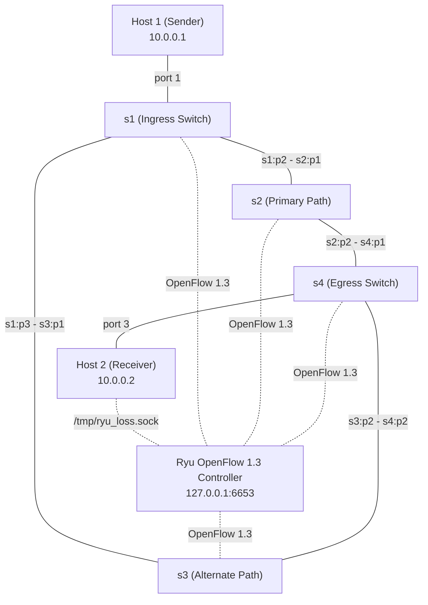

# Loss-Aware UDP Packet Loss Detection and Dynamic SDN Recovery (Merged D1 + D2)

This project implements a complete **UDP Packet Loss Detection and Recovery** application integrated with a **Ryu OpenFlow 1.3 SDN Controller** and a **Mininet** diamond network topology. It combines all architectural components, sliding/batch window tracking, and line-by-line documented implementation from **Deliverable 1 (`CN_Mini`)** with the session handshakes, port/link-failure detection, static vs. dynamic routing comparison, and automated recovery-time analyzer from **Deliverable 2 (`CN-Deliverable-2`)**.

## Project Objectives Covered

- **Implement UDP sequence tracking**: Every UDP packet carries a 14-byte network-order binary header (`!BQI?`) containing the packet type (`START`/`INI`, `START_ACK`/`INI_ACK`, `DATA`, `ACK`, `NACK`, `FIN`, `FIN_ACK`), a 64-bit random session ID, a 32-bit sequence number, and a retransmission flag (`retry` / `F_RETX`).
- **Detect missing packets**: The receiver tracks the sequence frontier (`frontier`), delivered packet set (`seen`), first-attempt arrivals (`originals`), and cumulative missing packet gaps (`gap_set`). It detects both out-of-order sequence gaps (`range(frontier, seq)`) and tail-of-window stalls (`200 ms` proactive window sweep).
- **Implement acknowledgments and retransmission**: The receiver immediately sends `ACK` packets for valid `DATA` datagrams and `NACK` packets for missing sequence numbers. The sender transmits in 10-packet windows (`WINDOW_SIZE = 10`), performing fast retransmission upon receiving a `NACK` and timeout-based retransmission (`250 ms` RTO) if an `ACK` does not arrive in time.
- **Monitor network paths**: The receiver computes first-attempt packet loss every `0.5 s` (including `100%` stall detection when traffic halts completely) and reports it over a Unix domain datagram socket (`/tmp/ryu_loss.sock`) to the Ryu controller. Simultaneously, the Ryu controller monitors OpenFlow switch and port status events (`EventOFPPortStatus`, `EventOFPPortDescStatsReply`, `EventOFPStateChange`).
- **Create alternate paths in Mininet**: `topo.py` builds a 2-host (`h1`, `h2`), 4-switch (`s1`, `s2`, `s3`, `s4`) diamond topology with two disjoint transit branches:
  - **Primary Path**: `h1 -> s1 -> s2 -> s4 -> h2`
  - **Alternate Path**: `h1 -> s1 -> s3 -> s4 -> h2`
- **Trigger dynamic rerouting**: In dynamic mode (`CN_MODE=dynamic`), the Ryu controller automatically switches bidirectional OpenFlow rules on `s1` and `s4` to the alternate path when either:
  1. Two consecutive high-loss windows (`loss >= 15.0%`) are reported by the receiver (`reason="sustained_loss"`), with a `5.0 s` hold-down timer to prevent route flapping, or
  2. An active link or switch on the current path goes down (`reason="link_or_switch_down"`).
- **Measure recovery time & compare packet loss before and after recovery**: `analyze.py` parses the timestamped JSONL logs from the sender, receiver, controller, and fault injector to measure `Fault to reroute command`, `Fault to ACK progress`, `Reroute to ACK recovery`, and first-attempt packet loss across `clean`, `pre_fault`, `impaired` (before recovery), and `post_reroute` (after recovery) phases.

## Network Topology



## Repository Files

| File | Purpose |
| --- | --- |
| `common.py` | Binary header format (`!BQI?`), packet/window constants (`START`/`INI`, `DATA`, `ACK`, `NACK`, `FIN`, `F_RETX`), `packet()`/`make()`/`parse()` helpers, and JSONL `log()` utility. |
| `topo.py` | Constructs the 2-host, 4-switch diamond Mininet topology with primary (`s2`) and alternate (`s3`) paths. |
| `controller.py` | Ryu OpenFlow 1.3 controller supporting static baseline (`CN_MODE=static`) and dynamic failover (`CN_MODE=dynamic`) on sustained packet loss or link/switch failure. |
| `sender.py` | Windowed, rate-paced UDP sender with `START`/`FIN` handshakes, `NACK` fast retransmission, and timeout recovery. |
| `receiver.py` | UDP receiver with sequence tracking, out-of-order and window-tail gap detection, `ACK`/`NACK` generation, and `0.5 s` loss reporting to Ryu. |
| `analyze.py` | Post-run log analyzer that computes before/after recovery packet loss, unique delivery, retransmissions, and recovery latency. |

## Quick Local Verification (No Mininet Required)

You can test the UDP protocol, sequence tracking, NACK/timeout recovery, and log analysis directly on localhost (`127.0.0.1`):

```bash
python3 receiver.py --local --deadline 15 > receiver.log 2>&1 &
python3 sender.py --dst 127.0.0.1 --count 50 --rate 200 --deadline 10 > sender.log 2>&1
python3 analyze.py sender.log receiver.log
```

Both `sender.log` and `receiver.log` will end with `"complete": true` and `Delivery: 50/50`.

## Running the Full Mininet + SDN Experiments

### 1. Start the Ryu Controller (Terminal 1)

```bash
CN_MODE=dynamic ryu-manager --ofp-tcp-listen-port 6653 controller.py > controller.log 2>&1
```

### 2. Start Open vSwitch and Mininet (Terminal 2)

```bash
sudo service openvswitch-switch start
sudo python3 topo.py
```

Verify connectivity at the `mininet>` prompt:

```text
links
h1 ping -c 1 10.0.0.2
```

### 3. Trial A — Clean Baseline Run

At the `mininet>` prompt:

```text
sh rm -f fault.log && touch fault.log
h2 python3 receiver.py --deadline 55 > receiver.log 2>&1 &
h1 python3 sender.py --count 2000 --rate 100 --deadline 45 > sender.log 2>&1
sh tail -n 1 sender.log receiver.log
sh python3 analyze.py sender.log receiver.log controller.log fault.log
```

### 4. Trial B — Dynamic Rerouting on Primary Link Failure

Capture initial flows, start the transfer in the background, and bring down the primary link (`s2-eth2`) after 5 seconds:

```text
sh ovs-ofctl -O OpenFlow13 dump-flows s1 > s1-before.log
sh ovs-ofctl -O OpenFlow13 dump-flows s4 > s4-before.log
h2 python3 receiver.py --deadline 55 > receiver.log 2>&1 &
h1 python3 sender.py --count 2000 --rate 100 --deadline 45 > sender.log 2>&1 &
```

Wait ~5 seconds, then inject the link failure:

```text
sh python3 -c "from common import log; log('fault')" > fault.log && ip link set dev s2-eth2 down
```

After the transfer completes, inspect the reroute event, updated OpenFlow rules, and recovery metrics:

```text
sh grep reroute controller.log
sh ovs-ofctl -O OpenFlow13 dump-flows s1 > s1-after.log
sh ovs-ofctl -O OpenFlow13 dump-flows s4 > s4-after.log
sh python3 analyze.py sender.log receiver.log controller.log fault.log
sh ip link set dev s2-eth2 up
```

### 5. Trial C — Dynamic Rerouting on Sustained Packet Loss (40% Netem Loss)

Start a fresh transfer on the primary path, wait ~5 seconds, and inject 40% packet loss on `s2-eth2`:

```text
h2 python3 receiver.py --deadline 55 > receiver.log 2>&1 &
h1 python3 sender.py --count 2000 --rate 100 --deadline 45 > sender.log 2>&1 &
```

After ~5 seconds:

```text
sh python3 -c "from common import log; log('fault')" > fault.log && tc qdisc replace dev s2-eth2 root netem loss 40%
```

Once the run finishes, analyze the before-recovery (`impaired`) vs. after-recovery (`post_reroute`) packet loss and clean up the netem rule:

```text
sh python3 analyze.py sender.log receiver.log controller.log fault.log
sh tc qdisc del dev s2-eth2 root
```

### 6. Trial D — Static Routing Baseline Comparison

Restart the controller with `CN_MODE=static`:

```bash
CN_MODE=static ryu-manager --ofp-tcp-listen-port 6653 controller.py > controller.log 2>&1
```

Repeat Trials B and C to compare static routing (where traffic remains pinned to the impaired primary path) against dynamic SDN rerouting.
