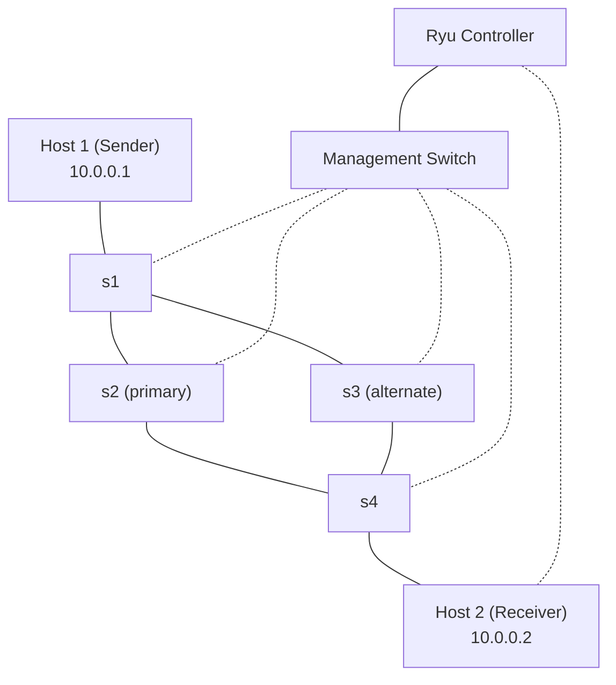

# Loss-Aware UDP Routing in Mininet

This project is a small software-defined networking experiment that demonstrates
loss-aware routing with Mininet, Open vSwitch, and a Ryu OpenFlow 1.3 controller.
Two Mininet hosts exchange UDP data through a four-switch topology with primary
and alternate paths. The receiver reports observed packet loss to the
controller, and the controller reroutes traffic when loss remains high.

## Features

- Custom UDP packet format with sequence numbers, timestamps, and packet types.
- Fixed-size sliding windows of 10 packets.
- ACK/NACK-based recovery for missing packets.
- Timeout-based retransmission at the sender.
- Periodic receiver loss reports over a Unix datagram socket.
- Controller-triggered switching between two OpenFlow paths.
- Hold-down logic to avoid repeatedly changing paths during a loss event.

## Topology



The links are represented by the following two routes:

- **Primary:** `h1 -> s1 -> s2 -> s4 -> h2`
- **Alternate:** `h1 -> s1 -> s3 -> s4 -> h2`

The hosts use `10.0.0.1` and `10.0.0.2`. The Ryu controller listens on
`127.0.0.1:6653`, and the receiver sends loss reports to
`/tmp/ryu_loss.sock`.

## Repository layout

| File | Description |
| --- | --- |
| [`topo.py`](./topo.py) | Builds the Mininet topology and starts the CLI. |
| [`controller.py`](./controller.py) | Ryu controller that installs flows and switches paths. |
| [`sender.py`](./sender.py) | Sends windowed UDP data and retransmits missing packets. |
| [`receiver.py`](./receiver.py) | Receives data, sends ACK/NACK responses, and reports loss. |
| [`common.py`](./common.py) | Packet header definitions, message types, and serialization helpers. |

## Requirements

Run the experiment on a Linux system with:

- Python 3
- Mininet
- Open vSwitch
- Ryu

Mininet and Open vSwitch normally require root privileges. Install Ryu in the
Python environment used to run the controller:

```bash
python3 -m pip install ryu
```

Use the distribution packages or Mininet installation instructions appropriate
for your Linux distribution to install Mininet and Open vSwitch.

## Running the experiment

Open three terminals from the project directory.

### 1. Start the Ryu controller

```bash
ryu-manager controller.py
```

The controller must be running before the Mininet switches connect.

### 2. Start Mininet

In a second terminal:

```bash
sudo service openvswitch-switch start
sudo python3 topo.py
```

Wait for the Mininet CLI to appear. The topology starts two hosts, four
OpenFlow 1.3 switches, and a remote controller connection.

### 3. Start the receiver

At the Mininet CLI, start the receiver on `h2`:

```text
mininet> h2 python3 receiver.py > h2.log 2>&1 &
```

### 4. Start the sender

Start the sender on `h1`:

```text
mininet> h1 python3 sender.py --dst 10.0.0.2 --count 2000 > h1.log 2>&1 &
```

To simulate a loss:
```text
mininet> h1 tc qdisc add dev h1-eth0 root netem loss 20%
```

Then run the sender python file once more.

The sender defaults to 2,000 packets and a 500-byte payload. It sends packets
in windows of 10, waits for ACKs, retransmits packets requested with NACKs or
detected by a timeout, and finally sends several `FIN` packets.

To stop Mininet after the run:

```text
mininet> exit
```

Then stop the Ryu controller with `Ctrl+C`.

## Observing loss and rerouting

The receiver prints per-window loss reports and sends the percentage to the
controller over `/tmp/ryu_loss.sock`. The controller considers a report of
15% or more to be high loss. After two consecutive high-loss windows, it
switches between the primary and alternate paths. A five-second hold-down
period prevents route flapping.

The controller logs path changes and loss reports in the terminal where
`ryu-manager` is running. The sender and receiver logs can be inspected from
the Mininet host namespaces:

```text
mininet> h1 tail -f h1.log
mininet> h2 tail -f h2.log
```

To introduce packet loss on a Mininet interface, use Linux traffic control
from the Mininet CLI. For example:

```text
mininet> h1 tc qdisc add dev h1-eth0 root netem loss 20%
```

Remove the impairment when finished:

```text
mininet> h1 tc qdisc del dev h1-eth0 root
```

The exact interface to impair depends on where loss is being simulated. Use
`net` or `links` in the Mininet CLI to inspect the topology.

## Protocol overview

Each packet starts with a 14-byte network-order header:

```text
!BBId
```

It contains:

1. Packet type (`INI`, `DATA`, `ACK`, `NACK`, `FIN`, or `INI_ACK`)
2. Flags (`F_RETX` marks a retransmission)
3. Sequence number
4. A sender timestamp

The receiver acknowledges data packets immediately. Missing sequence numbers
are reported with NACKs, and the sender retransmits the corresponding payload.
The receiver tracks original packets and gaps to calculate the loss percentage
reported to the controller.

## Notes

- Run the sender and receiver inside Mininet hosts, not from the root shell,
  so the traffic uses the emulated topology.
- The receiver must be started before the sender.
- The Unix socket path is fixed at `/tmp/ryu_loss.sock`; remove a stale socket
  only if the controller cannot bind it after an unclean shutdown.
- Generated `.log`, `.pyc`, and `__pycache__` files are ignored by Git.
